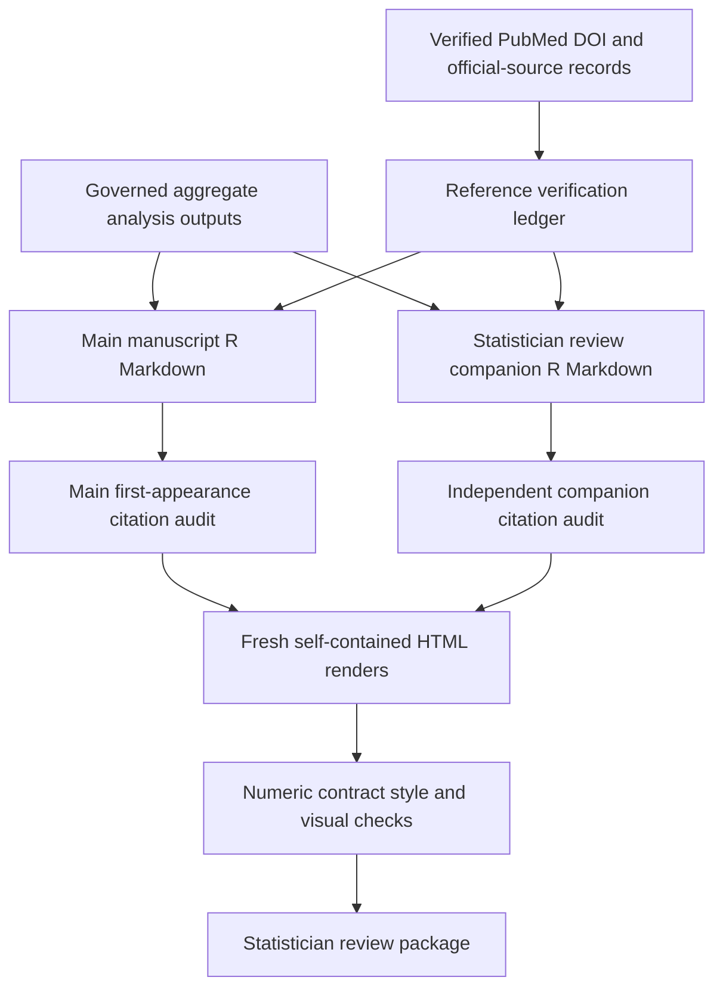

# Chicago Health Map Manuscript and Citation Audit Remediation - Plan

## Goal Capsule

- **Objective:** Give the independent biostatistician a clear, source-verified JAMA Health Forum Original Investigation review draft in which Chicago Health Map is the data resource and the tract-resolution analysis is one bounded worked use case.
- **Means:** Repair the main manuscript narrative and bibliography, move AUC claims out of the main article, update citation evidence records, add deterministic citation checks, and regenerate the self-contained review outputs without changing the primary estimators (KTD1-KTD5).
- **Authority:** The manuscript source and governed aggregate artifacts control reported values. The statistical analysis plan and tested analysis helpers control estimand definitions. Verified primary sources control citations. Human S7 review controls results authorization.
- **Execution profile:** One pull request. Preserve all pre-existing worktree changes and stage only files owned by this plan.
- **Stop conditions:** Stop rather than infer ethics, authorship, funding, disclosure, participating-system, or data-sharing facts. Stop if any proposed citation cannot be verified against a primary record. Stop if a fresh render changes a governed numeric result.

---

## Product Contract

### Summary

The main article will describe Chicago Health Map as a public, multisystem aggregate health-system resource that reports EHR-diagnosed proportions at several Chicago geographic levels with reliability and capture context. Hypertension and chronic obstructive pulmonary disease will demonstrate how much tract-level variation is not retained when the same source counts are aggregated to community areas among observed CAPriCORN adults. The analysis does not replace population surveillance. The revision will preserve the current descriptive and noncausal design while making the paper easier to read and every method citation easier to defend.

### Problem Frame

The current draft contains the correct primary leave-one-tract-out information-loss analysis, but its narrative alternates between a resource paper and a website evaluation. AUC is reported in the main article even though it uses a different exploratory comparator. Citation clusters obscure the scientific argument, several method citations are indirect or overbroad, and the bibliography is not numbered in first-citation order. These problems can produce editorial confusion or silent mis-citation even when the underlying estimates are correct.

### Requirements

**Scientific framing and statistical hierarchy**

- R1. Frame Chicago Health Map as the public multisystem aggregate data resource and the tract-versus-community-area analysis as one worked use case throughout the title page, Key Points, abstract, Introduction, Results, Discussion, and Conclusions. Describe only governed facts about the available conditions, geographic units, source population, reliability or capture context, and public access route.
- R2. Preserve the four primary ratio-of-sums leave-one-tract-out information-loss estimands and their existing governed numeric results.
- R3. Remove AUC imports, helpers, numeric Results, interpretation, and method claims from the main article while retaining the existing exploratory AUC analysis and explanation in the statistician review companion. A single nonnumeric pointer may identify the analysis as supplementary.
- R4. Keep source-published community-area values, ZCTA comparisons, empirical-Bayes shrinkage, suppression scenarios, cross-source concordance, and spatial analyses supplementary.
- R5. Keep the interpretation limited to EHR-diagnosed proportions among observed CAPriCORN adults and do not claim population prevalence, causation, tract superiority, community need, website effectiveness, or public health impact.

**Writing and reader flow**

- R6. Begin the abstract Results with one compact sentence describing the public aggregate resource from governed facts, then report cohort, hypertension, COPD, and main-text sensitivity findings while retaining every prespecified primary estimate and staying within the journal word limit.
- R7. Reduce large citation clusters to representative sources that directly support each claim, without retaining uncited references merely to meet a target count.
- R8. Reorganize the Discussion as principal finding, interpretation, bounded analyst use, and limitations. Limit practical use to interpreting geographic information loss and generating questions for comparison with population surveillance. Group limitations into source population, measurement, geography, and unmeasured website impact.
- R9. Remove internal preparation language about checking the journal instructions from scientific Methods while preserving internal compliance checks outside the article.

**Citation and evidence integrity**

- R10. Correct exact titles, author formatting, DOI or PMID metadata, official URLs, access dates, and erratum status from verified primary records.
- R11. Use direct citations for the implemented one-way method-of-moments variance partition, community-area cluster bootstrap, beta-binomial empirical-Bayes sensitivity, regression-residual Moran I, and spatial-error sensitivity.
- R12. Number the main bibliography by first appearance and independently preserve or recompute the statistician review companion bibliography if that document changes.
- R13. Expand the reference verification ledger so every retained source records its stable DOI, PMID, or official URL, verification authority and date, exact-title and erratum status, the claim or implemented method supported, a source locator when available, and support status. Update the claim-evidence map for revised locations and wording.
- R14. Add automated checks for sequential first citation, defined and cited references, duplicate stable identifiers, claim-to-reference ledger agreement, and the main-versus-companion AUC boundary.

**Governance and delivery**

- R15. Keep `results_authorized=false`, preserve the review-draft label, and leave unresolved ethics and author-supplied fields visible.
- R16. Regenerate self-contained main-manuscript and statistician review companion HTML from editable sources and do not hand-edit rendered outputs.
- R17. Verify focused and full repository checks, repeat rendering in fresh directories, citation completeness, aggregate-only outputs, and visual readability. Rerun the checks and one final render from an isolated checkout of the exact staged tree with required governed aggregate inputs supplied read-only.
- R18. Inventory and hash every pre-existing dirty path before editing. Preserve unrelated work, stage only reviewed baseline-to-final hunks, and stop if an owned file contains overlapping changes that cannot be separated safely.

### Success Criteria

- The abstract and main Results describe the public aggregate resource before the worked-use-case findings, and the paper contains no main-text AUC value, interpretation, or dependency.
- Every in-text reference resolves to one exact bibliography entry in first-appearance order, and every bibliography entry is cited.
- Each statistical method named in the main paper has a directly relevant verified source.
- The main abstract remains within 350 words, the main text remains within 3000 words, and the display count remains within the current JAMA Health Forum limit.
- A pre-edit snapshot binds every governed numeric value by stable result key. Two fresh renders preserve that snapshot exactly except for the main-text AUC values intentionally removed under R3.
- The final diff leaves authorization, ethics, and interpretation boundaries unchanged.

### Scope Boundaries

**In scope**

- Main-manuscript prose, references, citation ledgers, claim-evidence mapping, directly related tests, a scoped render or citation-audit helper when needed, and regenerated aggregate review outputs.
- Statistician review companion wording or bibliography only where needed to make the AUC comparator and method citations explicit.

**Considered and not built**

- Replacing the exploratory AUC estimator with the primary denominator-weighted comparator is not included because it would create a new statistical decision requiring separate statistician approval.
- Advancing S7 authorization is not included because only the independent reviewer can complete that governance step.
- Filling ethics, authorship, funding, disclosure, or data-sharing placeholders is not included because the repository does not establish those facts.
- Rewriting the master notebook or primary analysis helpers is not included unless verification shows a direct contradiction with the corrected manuscript.

---

## Planning Contract

### Key Technical Decisions

- KTD1. **Keep the primary estimator unchanged.** The tested ratio-of-sums leave-one-tract-out comparator and four information-loss estimands remain the scientific center of the paper because the audit found them appropriate for the descriptive question. Governs R2-R5.
- KTD2. **Treat AUC as companion-only.** Remove every main-article AUC dependency, value, method claim, and interpretation, but permit one nonnumeric pointer to the statistician review companion. Retain the existing exploratory module with its unweighted leave-one-out mean disclosed because changing that estimator would exceed this remediation scope. Governs R3-R4 and R14.
- KTD3. **Bind claims to stable sources before renumbering.** Finalize the evidence set and claim-to-source manifest keyed by DOI, PMID, or official URL, then apply one deterministic first-appearance renumber across the main article so prose edits cannot silently change source identity. Governs R7 and R10-R14.
- KTD4. **Use verification authority appropriate to each source.** PubMed and DOI registry records govern journal metadata, official agencies govern datasets and reports, and Paperclip evidence informs claim support without substituting for primary-source verification. Governs R10-R13.
- KTD5. **Regenerate, never patch, outputs.** R Markdown files remain the editable sources. HTML and Markdown review artifacts are recreated from those sources and compared across clean renders. Governs R16-R18.
- KTD6. **Preserve fail-closed governance.** Manuscript improvement does not change `results_authorized=false`, S7 status, or unresolved factual placeholders. Governs R15.

### High-Level Technical Design

The main article and statistician review companion keep independent numbered bibliographies. Governed aggregate outputs remain the only numeric source. The citation audit binds each manuscript claim to a verified reference and checks ordering before final rendering.

### Assumptions

- The existing AUC module in the statistician review companion is sufficient after its comparator distinction is made explicit.
- Existing governed aggregate outputs remain numerically correct and will not be regenerated unless a contract check fails.
- Exact bibliography metadata already verified in the audit can be recorded without changing investigator screening decisions.
- The governed semantic checksum is a hash of normalized rendered scientific text and table values after stripping only identified tool-generated metadata. The implementation will test the normalizer and will not substitute semantic equivalence for an unexplained byte difference.

### Risks and Dependencies

- The heavily dirty worktree creates a high risk of sweeping unrelated edits into the commit. Capture per-file diffs and hashes before editing, stage only plan-owned hunks, inspect the cached diff, and verify the exact staged tree in isolation.
- Citation reduction can orphan references or change numbering. The first-appearance audit must run after every prose or bibliography change.
- The main and statistician review companion bibliographies can diverge. Audit them independently.
- Two references have linked errata. Confirm whether their corrected content affects the manuscript claims before formatting any erratum notice.
- The current abstract is near its word limit. Recount the rendered abstract after every revision.

---

## Implementation Units

### U1. Clarify the paper and move AUC to the statistician review companion

- **Goal:** Produce one coherent main-article narrative centered on Chicago Health Map as the resource and geographic resolution as the worked use case.
- **Requirements:** R1-R9, R15.
- **Dependencies:** None.
- **Files:** `manuscript/chicago_health_map_jama_health_forum_original_investigation.Rmd`, `notebooks/RMD_chm_paper_r_Ashley.Rmd`, `manuscript/claim_evidence_map.csv`, and focused manuscript contract tests under `tests/unit/`.
- **Approach:** Remove the main Rmd's AUC import, helper, numeric Results, interpretation, and method claim. Retain exactly one nonnumeric pointer naming `RMD_chm_paper_r_Ashley.html` as the statistician review companion. Retain Table 1 and Figure 1 as bounded resource context. Rewrite the title, Key Points, Objective, abstract, Results lead-in, final Introduction paragraph, Discussion, and Conclusions around one worked use case. Convert the 9-item limitations paragraph into four continuous prose paragraphs and remove the journal-instructions sentence from scientific Methods.
- **Patterns to follow:** `docs/manuscript/jama_health_forum_style_guide.md`, the existing companion AUC module, and the approved phrase “EHR-diagnosed proportion among observed CAPriCORN adults.”
- **Test scenarios:**
  1. The main source contains no AUC helper, value lookup, result claim, interpretation, or AUC method citation, but it may contain the one nonnumeric companion pointer.
  2. The statistician review companion still contains the exploratory AUC estimate, uncertainty, comparator definition, and validation limitations.
  3. The abstract contains all four primary estimands for both conditions and remains within 350 words.
  4. Main text retains explicit nonpopulation, noncausal, and supplement-not-replace boundaries.
  5. `results_authorized=false` and unresolved factual placeholders remain unchanged.
  6. The title and Key Points contain no AUC, population-prevalence, website-effectiveness, or community-need claim.
- **Verification:** The manuscript contract and style audits pass, numeric claims still match governed tables, and a reader can identify the resource, study question, population, comparator, and interpretation boundary from the abstract alone.

### U3. Add regression checks for manuscript boundaries and citation order

- **Goal:** Prevent future edits from reintroducing AUC to the main paper or corrupting numeric reference order.
- **Requirements:** R12-R14 and R17-R18.
- **Dependencies:** U1.
- **Files:** `src/chicagohealthmap/manuscript/audit.py`, `src/chicagohealthmap/cli.py`, `tests/unit/manuscript/test_audit.py`, and `tests/integration/test_manuscript_control_cli.py`.
- **Execution note:** Characterize the U1 manuscript state and prove audit behavior with controlled valid and invalid fixtures before changing shared audit behavior.
- **Approach:** Extend the existing manuscript audit and CLI rather than creating a parallel framework. Check first-appearance sequence, undefined and uncited references, duplicate stable identifiers, reference-range validity, claim-to-ledger agreement, one allowed nonnumeric AUC pointer in the main article, complete AUC presence in the statistician review companion, and preservation of authorization language. Reject main-article AUC imports, helpers, values, method claims, or interpretation. Add a deterministic first-appearance renumber helper, but require explicit reviewed additions and removals from `manuscript/reference_verification.csv`.
- **Patterns to follow:** `src/chicagohealthmap/manuscript/audit.py`, existing manuscript CLI commands, `tests/unit/manuscript/test_audit.py`, and `tests/integration/test_manuscript_control_cli.py`.
- **Test scenarios:**
  1. A controlled valid fixture passes every citation invariant.
  2. A fixture with a skipped first citation fails with the exact missing number.
  3. A fixture with an undefined citation, an uncited reference, or duplicate DOI fails deterministically.
  4. A fixture with one nonnumeric companion pointer passes, while a fixture with a main-text AUC value, import, helper, method claim, or interpretation fails.
  5. A fixture that changes `results_authorized=false` or removes the review boundary fails.
  6. A retained citation with no stable ledger identifier, support status, or claim-map location fails.
- **Verification:** Focused unit tests prove each failure mode, and the full repository suite remains green.

### U2. Repair citations, references, and evidence ledgers

- **Goal:** Make every retained citation exact, directly relevant, traceable, and correctly numbered.
- **Requirements:** R7 and R10-R14.
- **Dependencies:** U1 and U3.
- **Files:** `manuscript/chicago_health_map_jama_health_forum_original_investigation.Rmd`, `notebooks/RMD_chm_paper_r_Ashley.Rmd` when companion citations change, `manuscript/reference_verification.csv`, `manuscript/claim_evidence_map.csv`, and `sources/SOURCE_REGISTRY.yml` only if a verified official URL is missing.
- **Approach:** Select representative evidence for each prose claim, add direct verified method references, correct exact metadata, review linked errata, and add official dataset URLs. Record the full source consulted, method or claim supported, locator when available, and support status. Remove the main JAMA-instructions citation and uncited entries. Rebuild the main bibliography in first-appearance order from stable source identifiers. Audit the companion independently and update evidence ledgers without marking investigator screening complete.
- **Patterns to follow:** Existing AMA reference formatting, the source registry for official data URLs, PubMed records for biomedical articles, DOI registry records for exact metadata, and the evidence-ledger conventions in `docs/solutions/2026-07-14-gate-2-evidence-audit.md`.
- **Test scenarios:**
  1. Every in-text numeric reference exists and every reference-list entry is cited.
  2. First appearances are sequential and citation ranges expand to the correct identifiers.
  3. No retained DOI or PMID appears twice under different numbers.
  4. The variance, cluster-bootstrap, empirical-Bayes, residual-Moran, and spatial-error descriptions each cite a source that directly supports the implemented method.
  5. References to AUC, Gwet AC1, local Moran I, Getis-Ord, and false-discovery-rate procedures appear only where those analyses are actually described.
  6. The verification ledger records the primary authority, verification date, exact-title status, erratum status, supported claim or method, and support status for each retained source.
  7. The corrected main manuscript and statistician review companion pass every citation invariant after the repaired references are in place.
- **Verification:** The completed citation audit passes for the main article and statistician review companion, and spot checks against PubMed, DOI records, and official dataset pages match the formatted references.

### U4. Regenerate and inspect the review package

- **Goal:** Deliver fresh self-contained manuscript and statistician review companion HTML that reproduce the corrected sources.
- **Requirements:** R16-R18.
- **Dependencies:** U1-U3.
- **Files:** `scripts/manuscript/render_review_package.R`, `outputs/statistician-review/chicago_health_map_jama_health_forum_original_investigation.html`, `outputs/statistician-review/chicago_health_map_jama_health_forum_original_investigation.md`, `outputs/statistician-review/RMD_chm_paper_r_Ashley.html`, and any governed audit report produced by the existing manuscript tooling.
- **Approach:** Add one checked-in render entry point that accepts an output directory, renders the main article and statistician review companion with fixed names, keeps the main Markdown intermediate, and computes governed semantic checksums. Render both documents twice in separate fresh local directories, compare checksums, then render final named outputs. Run statistical, citation, JAMA-style, lint, type, and full test checks. Inspect the HTML for headings, citations, tables, figure, wrapping, navigation, and review warnings.
- **Patterns to follow:** The R Markdown render command in `README.md`, self-contained HTML settings in the existing Rmd files, and repository public-release checks.
- **Test scenarios:**
  1. Both documents render without warnings or missing aggregate inputs.
  2. Two fresh renders match exactly or produce a documented and tested semantic equivalence when only nondeterministic metadata differs.
  3. The main HTML has no numeric AUC claim and the statistician review companion retains the complete exploratory AUC section.
  4. The rendered main text, abstract, reference count, citation order, and display count meet the configured journal contract.
  5. No row-level data, protected source path, credential, or unauthorized manuscript-import artifact appears in either HTML file.
  6. Every local companion filename cited by the main HTML exists in `outputs/statistician-review/`.
- **Verification:** All commands in the Verification Contract pass, visual inspection finds no layout defects, and `git diff --check` is clean.

---

## Verification Contract

| Check | Scope | Done signal |
|---|---|---|
| Focused statistical tests | `tests/unit/analysis/test_tract_complementarity.py`, `tests/unit/analysis/test_master_notebook_contract.py` | Ratio-of-sums pooling and focal-tract exclusion remain protected |
| Manuscript and citation tests | `tests/unit/manuscript/`, `tests/unit/test_jama_style_audit.py`, and new focused citation tests | All citation, AUC-placement, and governance invariants pass |
| Citation and ledger audit | `uv run chicagohealthmap manuscript audit-citations --main manuscript/chicago_health_map_jama_health_forum_original_investigation.Rmd --companion notebooks/RMD_chm_paper_r_Ashley.Rmd --references manuscript/reference_verification.csv --claims manuscript/claim_evidence_map.csv` | First-use order, stable identifiers, claim support, companion placement, and authorization boundaries pass |
| JAMA manuscript audit | Current manuscript audit scripts and configured journal contract | Title, abstract, Key Points, main text, references, and displays pass |
| Static checks | `uv run ruff check .` and `uv run mypy src` | No lint or type errors |
| Full test suite | `uv run pytest` | All tests pass |
| Notebook contract | `uv run marimo check --strict notebooks/00_master_chicago_healthmap_pipeline.py` | Strict validation passes without modifying notebook logic |
| Public release check | `./scripts/test_public_release.sh` | Aggregate-only release checks pass |
| Repeat render | `scripts/manuscript/render_review_package.R` run twice in fresh directories | Matching byte checksums, or matching tested governed semantic checksums after an identified metadata-only difference |
| Isolated staged-tree verification | Confirm the staged path allowlist, run `git diff --cached --check`, materialize `git archive $(git write-tree)` in a temporary directory, verify and copy only required ignored inputs from the governed checksum manifest as read-only, then run static checks, full tests, release checks, citation audit, and one render | The exact reviewed commit candidate passes without unrelated staged paths or mutable source inputs |
| Visual review | Final self-contained HTML files | Equations, citations, tables, figure, wrapping, navigation, and warnings are readable |
| Diff hygiene | `git diff --check` plus scoped status review | No whitespace errors and no unrelated paths staged |

---

## Definition of Done

- U1 is complete when the main article has one clear resource-plus-use-case story, all eight primary estimates remain, only one nonnumeric AUC pointer appears in the main article, and every interpretation boundary remains explicit.
- U2 is complete when the main references follow first appearance, exact metadata and official URLs are corrected, direct method sources are present, errata are reviewed, and both evidence ledgers agree with the manuscript by stable source identifier.
- U3 is complete when regression tests fail on misnumbered citations, undefined or uncited references, duplicate identifiers, disallowed main-text AUC content, and authorization drift while permitting one nonnumeric companion pointer.
- U4 is complete when fresh main and statistician review companion renders pass statistical, citation, journal, static, full-suite, release, and visual checks.
- The final commit contains only files owned by this plan. Pre-existing unrelated changes remain untouched.
- No abandoned scripts, temporary render directories, provisional citation maps, or dead-end edits remain in the diff.
- The package remains a statistician-review draft, not a submission-ready or S7-authorized manuscript.
