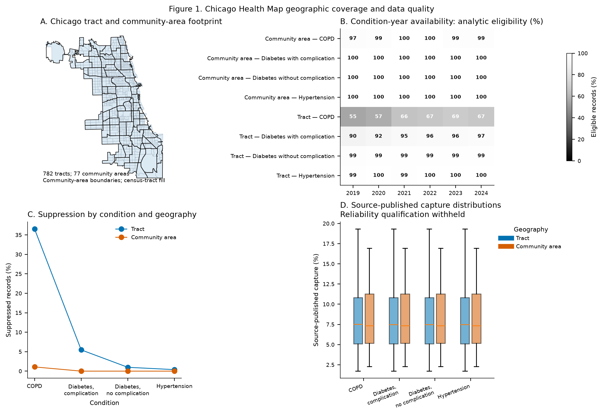

<strong>Statistician review draft.</strong> Governed aggregate results
are shown so the independent statistician can review the estimands,
uncertainty procedures, diagnostics, and interpretation. The
authorization gate remains <code>results_authorized=false</code>. This
file is not ready for manuscript import or submission until S7 review
and the unresolved article-information fields are complete.

# Chicago Health Map and Tract-Level Information Beyond Community-Area Summaries

**Title:** Chicago Health Map and Tract-Level Information Beyond
Community-Area Summaries

**Article type:** Original Investigation

**Authors:** \[Insert full author names and highest academic degrees\]

**Affiliations:** \[Insert institutional affiliations\]

**Corresponding author:** \[Insert name, postal address, telephone
number, and email address\]

**Manuscript word count:** \[Insert validated main-text word count after
final author revision\]

**Tables and figures:** 2 tables and 1 figure

# Key Points

Question:

When Chicago Health Map tract estimates are replaced by community-area
summaries, how much information about electronic health record–diagnosed
proportions is no longer visible?

Findings:

In this ecological study, community-area summaries changed quartile
classification for 33.8% of 720 hypertension tracts and 52.4% of 401
chronic obstructive pulmonary disease tracts. Within-community variation
accounted for 19.5% and 46.9% of observed tract variation, respectively.

Meaning:

Chicago Health Map can supplement population surveillance by showing
clinically observed small-area variation within familiar reporting
units. Its estimates do not represent all residents and cannot establish
community need.

# Abstract

## Importance

Chicago Health Map displays aggregate multisystem electronic health
record diagnosis data by census tract and larger geographic units. Its
value depends on whether tract estimates add information beyond larger
reporting areas and retain clear health-system denominator limits.

## Objective

To describe Chicago Health Map and demonstrate a geographic-resolution
use case by quantifying tract-level information not retained by
leave-one-tract-out community-area summaries.

## Design

Ecological repeated cross-sectional study of aggregate records from 2019
through 2024, with primary analyses pooling 2022 through 2024.

## Setting

Chicago, Illinois.

## Participants

Adults observed in participating Chicago Area Patient-Centered Outcomes
Research Network systems. The annual denominator used source-defined
adults with at least 1 of 39 conditions. The study team reports annual
cross-system deduplication, which could not be independently verified
from aggregate files.

## Exposures

Crude tract-level electronic health record–diagnosed proportions for
hypertension and chronic obstructive pulmonary disease.

## Main Outcomes and Measures

Outcomes were within-community variance share, median absolute
percentile-rank difference, quartile disagreement, and highest-quartile
movement. Each tract was compared with the pooled estimate from other
eligible tracts in its community area. Community-area cluster bootstraps
provided percentile 95% CIs.

## Results

Chicago Health Map included 1848 community-area condition-year records.
The primary analysis included 720 hypertension tracts and 401 chronic
obstructive pulmonary disease (COPD) tracts. For hypertension,
within-community variance share was 19.5% (95% CI, 15.1%-27.6%). Median
absolute rank difference was 0.085 (95% CI, 0.080-0.104), quartile
disagreement was 33.8% (95% CI, 28.9%-43.4%), and highest-quartile
movement was 11.7% (95% CI, 6.7%-20.0%). Corresponding COPD estimates
were 46.9% (95% CI, 33.3%-62.1%), 0.145 (95% CI, 0.125-0.173), 52.4%
(95% CI, 47.3%-61.6%), and 23.4% (95% CI, 18.1%-33.8%).

## Conclusions and Relevance

Community-area summaries did not retain all tract-level variation.
Chicago Health Map can identify small-area questions for follow-up with
population surveillance and local evidence. It should supplement, not
replace, resident-population data.

# Introduction

Local public health agencies need geographically specific information to
monitor chronic disease and guide investigation. Surveys and modeled
estimates provide a population frame, but sample size, release
schedules, and privacy protections can limit neighborhood comparisons.
Electronic health records (EHRs) can add timely clinical observations
and support chronic disease surveillance, small-area estimation, and
multisite reporting.1-5 Their interpretation must account for
selection through health care access, utilization, participating
institutions, documentation, and data linkage.6-12

This distinction matters within cities. EHR measures describe diagnoses
among people observed in care, whereas surveys and modeled estimates
target resident populations.3-4,7,13-15 Neither source is a
gold standard for the other. Health-system data can show where
clinically recorded patterns vary within public reporting units and
identify questions for examination with population-based evidence.

Chicago Health Map is a public interactive website maintained by the
Rush Health Equity Data Analytics Studio. It displays annual aggregate
diagnosis percentages from the Chicago Area Patient-Centered Outcomes
Research Network (CAPriCORN) for 38 chronic conditions and firearm
injury across 6 counties in metropolitan Chicago. Visitors can select a
condition, year, demographic group, and geographic unit. A shaded map
presents the percentage diagnosed, identifies areas with insufficient
data, and provides reliability information based on patient coverage and
demographic alignment. Census tracts provide the most detailed view, and
the website also presents Chicago’s 77 community areas. These
percentages describe recorded diagnoses among adults observed in
participating systems, not disease prevalence among all
residents.16-18

We describe the public website, its data sources, and its interpretation
limits, then evaluate one scientific use case. Because the website
displays the same condition at different geographic resolutions, we
asked how much tract-level information is no longer visible when
validated tract counts are summarized at the community-area level. We
hypothesized that tract estimates would show within-community variation
for hypertension and chronic obstructive pulmonary disease (COPD). The
prespecified interpretation excluded population prevalence, causal
effects, and evidence of community need.

# Methods

## Study Design and Data Sources

We conducted an ecological repeated cross-sectional study of aggregate
Chicago Health Map records from 2019 through 2024. The primary
geographic-resolution analysis pooled 2022 through 2024, years selected
to provide a contemporary 3-year period with consistent source fields.
CAPriCORN supplied the clinical network context. American Community
Survey data supplied area covariates for supplementary models. City of
Chicago and US Census Bureau files supplied geographic boundaries and
tract relationships. CDC PLACES, Healthy Chicago Survey, and Chicago
Health Atlas data supported secondary cross-source
analyses.16-22 Reporting followed STROBE and RECORD
guidance.23-24

## Chicago Health Map Website and Data Resource

ChicagoHealthMap.com presents a public choropleth map of aggregate
diagnosis percentages. Visitors can select a condition and geographic
unit, filter by year, age, race and ethnicity, and gender, and inspect
areas labeled as having insufficient data. The website also displays
source-provided reliability information and optional contextual layers,
including social vulnerability and neighborhood resources. The clinical
source period spans 2019 through 2024 across Cook, DuPage, Lake, Will,
Kane, and McHenry Counties. Census tracts are the primary small-area
unit. Within Chicago, the website also presents the city’s 77 community
areas.16,18

The public resource combines CAPriCORN diagnosis aggregates with
American Community Survey population and demographic estimates, US
Census Bureau TIGER tract boundaries, and Chicago Data Portal
community-area boundaries. Its contextual layers draw on the CDC and
Agency for Toxic Substances and Disease Registry Social Vulnerability
Index, OpenStreetMap, Chicago Police Department records, and City of
Chicago 311 data. CAPriCORN contributors standardize structured records
with the PCORnet Common Data Model. Diagnoses are defined from
International Classification of Diseases, 10th Revision codes. Values
based on fewer than 10 people are suppressed, and reliability flags
summarize patient capture and demographic alignment.17-18

This study used the governed aggregate exports underlying the website
rather than values transcribed from the map. We restricted the analysis
to Chicago and compared the census tract view with community-area
summaries constructed from the same validated tract numerators and
denominators. The primary analysis used CAPriCORN diagnosis aggregates
and geographic crosswalks. American Community Survey variables entered
only supplementary models. The website’s retail, service, crime, and
social vulnerability layers were not analyzed. The study evaluated the
geographic information provided by the underlying data. It did not
evaluate website usability, community engagement, or whether viewing the
map changed policy or resource decisions.

The analytic unit was a geography-condition-year aggregate. No
patient-level records were used. For each tract and condition, the
numerator was the annual source-defined count of adults with the
diagnosis, and the denominator was the annual source-defined count of
adults with at least 1 of 39 included conditions who were observed that
year. The study team reports that the upstream data integration process
deduplicated adults across systems within each year. The aggregate files
did not permit independent verification of person-level linkage or
identification of people appearing in multiple years. We therefore refer
to every estimate as an EHR-diagnosed proportion among observed
CAPriCORN adults, not population prevalence.

## Eligibility and Geographic Linkage

Tracts had to fall within the frozen Chicago boundary definition, have a
denominator of at least 30, have an observable numerator and
nonsuppressed estimate, and contribute all 3 primary years. We assigned
each tract to its dominant community area only when the maximum overlay
weight was at least 0.99. The leave-one-out comparator also required
another eligible tract in that community area. These rules yielded 777
complete hypertension tracts and 448 complete COPD tracts before
dominant-area linkage, 722 and 411 after linkage, and 720 and 401 with a
leave-one-out comparator.

We treated unresolved zero-or-suppressed values as informative
missingness. The primary analysis used complete cases. Scenario analyses
replaced an unresolved numerator with 0 or with the smaller of 9 and the
denominator. These scenarios were not interpreted as formal bounds.
Age-standardized estimates were not computed. Stored age-stratum fields
were present, but their sums rarely matched the all-age totals, their
suppression semantics were undocumented, and no compatible standard
population had been approved.

## Primary Estimands

We summed annual numerators and denominators before division. For focal
tract <i>i</i> in community area <i>j</i>, the pooled tract estimate was
<i>p</i><i>ij</i> = ∑<i>t</i>
<i>y</i><i>ijt</i> / ∑<i>t</i>
<i>n</i><i>ijt</i>. Its community-area comparator excluded
the focal tract: <i>p</i>−<i>i</i>,<i>j</i> = ∑<i>k</i>
≠ <i>i</i>,<i>t</i> <i>y</i><i>kjt</i> / ∑<i>k</i>
≠ <i>i</i>,<i>t</i> <i>n</i><i>kjt</i>. Tests prevented
substitution of an unweighted mean of annual percentages and verified
that each focal tract contributed neither numerator nor denominator to
its comparator.

We estimated 4 complementary outcomes. First, the within-community
variance share was the observed-scale within-area component divided by
total tract variance using a one-way method-of-moments
partition.25-26 Second, we calculated the median absolute
difference between empirical tract and leave-one-out comparator
percentile ranks. Third, we measured disagreement across quartiles
defined by fixed percentile boundaries at 0.25, 0.50, and 0.75, using
average ranks for ties. Fourth, we measured movement into or out of the
highest quartile. No magnitude threshold was defined after observing the
results.

## Uncertainty and Sensitivity Analyses

We resampled community areas with replacement, retained their member
tracts, and recomputed ranks and categories within each replicate. The
primary analysis used 1000 replicates, seed 20260715, and the 2.5th and
97.5th percentiles.27-29 We used the same design for all 4
primary estimands.

To quantify finite-denominator variation, we ran 1000 binomial
simulations using each tract-year denominator and its leave-one-out area
probability. This simulation was a noise reference, not a
measurement-error correction. We also applied beta-binomial
empirical-Bayes shrinkage as a sensitivity, while retaining unshrunk
estimates as primary.30 Source-published community-area
values and Census ZIP Code Tabulation Area values were secondary because
their weighting and condition-specific denominators were not fully
documented. Cross-source Spearman correlation and quadratic weighted
kappa described alignment without treating either source as
correct.31

Supplementary community-area models used ordinary least squares with HC3
covariance, residual-degrees-of-freedom (t) critical values, and 95%
CIs.32 The locked adjustment set was percentage aged 65 years
or older, percentage female, percentage below the federal poverty level,
and mean 2022 through 2024 capture. Regression-residual Moran I used
row-standardized queen weights and 9999 fitted-design null simulations.
Spatial error models were sensitivities.33-35 Combined
diabetes was not analyzed because mutual exclusivity and denominator
equivalence were not established. We applied NCHS reliability principles
cautiously because they were developed for survey estimates rather than
EHR denominators.36

Analyses used Python 3.13.14 (Python Software Foundation) with pandas
3.0.3, NumPy 2.5.1, SciPy 1.18.0, statsmodels 0.14.6, and Matplotlib
3.11.0. The review manuscript was rendered in R 4.6.1 (R Foundation).
All CIs were 2-sided 95% intervals.

## Ethics

The final institutional review board determination, approval or
exemption identifier, consent or waiver determination, and governing
institution have not been supplied for this review draft. The study
owner must confirm these items before submission. The aggregate nature
of the analytic files is not used to infer an ethics determination.

# Results

## Data Availability and Cohort Flow

The community-area resource contained 1848 condition-year records across
77 community areas and 6 years (Table 1). Hypertension records were
complete across all 462 area-years. 5 of 462 COPD area-year records
(1.1%) were suppressed. The source-published median condition-record
denominator was 3,193 for hypertension and 3,163 for COPD. These
denominators were geography-period-condition observations, not counts of
unique people across the study period.

Among 782 Chicago-boundary tracts for hypertension, 777 had complete
2022 through 2024 data, 722 met the dominant-area criterion, and 720 had
another eligible tract in the area. For COPD, the corresponding counts
were 782, 448, 411, and 401 (Figure 1). The greater COPD attrition
reflected unresolved or suppressed values and tracts without a
focal-condition source row, not exclusion from the common Chicago
boundary.

For COPD, the 401 included tracts had a median annual denominator of
409, compared with 289 among the 381 excluded tracts. Excluded COPD
tracts contributed 779 unresolved or ineligible tract-year records. The
COPD results therefore describe a more selected tract sample than the
hypertension results. These aggregate comparisons do not identify the
direction or magnitude of selection bias.

## Primary Geographic-Resolution Estimates

For hypertension, within-community variation accounted for 19.5% (95%
CI, 15.1%-27.6%) of observed tract variation (Table 2). The median
absolute percentile-rank difference was 0.085 (95% CI, 0.080-0.104).
Community-area summaries assigned 33.8% (95% CI, 28.9%-43.4%) of tracts
to a different quartile and changed highest-quartile status for 11.7%
(95% CI, 6.7%-20.0%).

For COPD, within-community variation accounted for 46.9% (95% CI,
33.3%-62.1%) of tract variation. The median absolute rank difference was
0.145 (95% CI, 0.125-0.173). Quartile disagreement affected 52.4% (95%
CI, 47.3%-61.6%) of tracts, and highest-quartile status changed for
23.4% (95% CI, 18.1%-33.8%).

Exploratory AUC analyses are reported only in the statistician review
companion, `RMD_chm_paper_r_Ashley.html`.

## Sensitivity Analyses

For the noise comparison, all 4 metrics were recomputed in the
leave-one-tract-out simulation frame of 720 hypertension tracts and 401
COPD tracts. The variance-share noise contrast therefore used a narrower
population than the primary variance-share estimate. For hypertension,
observed minus noise-only median differences were 15.9 percentage points
for within-community variance share, 0.038 percentile-rank units, 19.0
percentage points for quartile disagreement, and 6.1 percentage points
for highest-quartile movement. The corresponding COPD differences were
31.5 percentage points, 0.060, 15.7 percentage points, and 7.0
percentage points. These contrasts describe excess over the simulation
median and are not bias-corrected estimates. Empirical-Bayes shrinkage
produced quartile-disagreement estimates of 33.5% for hypertension and
52.1% for COPD. The primary estimate and finite-denominator review
graphics are reported in the statistician review companion.

Suppression scenarios did not change hypertension estimates. For COPD,
imputing unresolved numerators as 0 produced 48.9% quartile
disagreement, whereas assigning up to 9 produced 52.2%. Corresponding
highest-quartile movement was 16.8% and 16.5%. These scenarios included
713 tracts and therefore changed both the values and the analytic
population. Source-published community-area, noncrossing-tract, ZCTA,
reliability-stratified, cross-source, and annual analyses are reported
in the statistician review companion. They were treated as sensitivities
rather than independent standards.

# Discussion

In this worked use case of Chicago Health Map, community-area summaries
retained broad geographic signal but did not retain all clinically
observed tract variation. The estimated magnitudes differed between COPD
and hypertension, but the study did not prespecify or estimate
between-condition contrasts. Empirical-Bayes shrinkage and
finite-denominator simulations tested how much the result depended on
unstable crude proportions. The simulation contrasts were descriptive
and did not remove measurement error. These results support a
supplementary role for small-area health-system data: they can identify
variation within common public reporting units that merits investigation
with population-based and community evidence.

The results do not imply that tract estimates are more accurate than
community-area estimates. The leave-one-out design answered a narrower
question by comparing each tract with a coarser summary constructed from
other tracts in the same source frame. This avoided allowing the focal
tract to define its own comparator and avoided treating source-published
community-area values as a gold standard. Prior EHR surveillance studies
have similarly shown that routine clinical data can provide timely
neighborhood information while remaining sensitive to patient capture,
phenotype definitions, participating systems, and
utilization.7-15,37-44

COPD and hypertension differed in data completeness and estimated
information loss. COPD had more unresolved or suppressed tract-years,
fewer complete tracts, and wider uncertainty. Its tract-community
differences therefore coexist with a more selected analytic frame.
Hypertension had near-complete tract availability and also showed
within-area differences. The study did not assign a threshold for
practical importance, test a between-condition contrast, or establish
where services are needed. A tract flagged by this analysis is a place
where the EHR-derived description differs from its area’s summary, not
evidence of underdiagnosis, poor care, disease burden, or an
intervention target.

The noise simulation addressed one source of measurement uncertainty.
The observed-minus-simulation contrasts quantified how far each primary
metric lay above or below the noise-only median. The simulation assumed
binomial variation around the leave-one-out area probability and did not
represent diagnostic misclassification, health-system selection,
extra-binomial variation, geocoding error, spatial dependence,
cross-year dependence, or changes in participating institutions.
Shrinkage stabilized crude proportions under a beta-binomial model but
could not correct the EHR population to the resident population.

Chicago Health Map can complement public health data when each source
retains its own inferential boundary. Population surveys, vital records,
and modeled surveillance remain necessary for resident-population
inference. Health-system records can add a clinically grounded
tract-level signal and can be refreshed on different schedules. Used
together, the sources can identify discordant areas, generate hypotheses
about ascertainment or access, and support targeted data-quality review.
They should not be combined as if they measure the same population, and
EHR estimates should not independently direct resource allocation. The
same principle underlies multisite EHR surveillance networks and health
information exchange programs.1,9,12,14,40-44

The website supports several bounded, practical uses. A public health
team can use the tract view to determine whether a community-area
average conceals smaller-area differences, then examine those
differences with population surveillance and local knowledge. A health
system can review a diagnosis pattern beside capture and reliability
information to identify places that require data-quality or
ascertainment review. A community organization can use a community
snapshot to frame questions for local partners and request more specific
evidence. These examples concern question generation and measurement
review. This study did not test whether the website changed programs,
resource allocation, or health outcomes.

## Limitations

The denominator included adults observed in participating systems who
had at least 1 of 39 conditions. It did not represent all Chicago
residents, all health care users, or all adults with the focal
condition. The study team reports that annual cross-system deduplication
was performed upstream, but the aggregate files could not verify linkage
or identify people observed in multiple years.

The measures were crude. Age fields were present, but they did not
additively reconcile with the all-age totals and their suppression
semantics were undocumented. Available aggregate data therefore did not
support defensible age standardization, and differences in tract
composition could contribute to the observed variation. Unresolved and
suppressed records were informative, particularly for COPD. The scenario
analyses changed the analytic population and were not formal bounds.

Geographic assignment depended on geocoding, boundary vintages, and the
0.99 dominant-area rule. Results may differ with other neighborhood
definitions. Reliability categories were supplied by the source. The
relationship between the internal 5-tier labels and the public 4-tier
framework still requires source-owner confirmation.

The study evaluated 2 conditions in 1 metropolitan network without
temporal holdout or external replication. Ecological findings cannot be
interpreted for individuals or as causal effects. The study evaluated
the aggregate data underlying the website. It did not test whether the
website changed understanding, decisions, resource allocation, or health
outcomes.

## Conclusions

Tract-level Chicago Health Map measures contained clinically observed
geographic information that leave-one-out community-area summaries did
not fully retain. The findings support using health-system research data
to supplement public health surveillance and generate small-area
questions, while preserving population-based data as the basis for
community inference and action.

# Article Information

**Accepted for Presentation:** Not applicable unless confirmed by the
authors.

**Author Contributions:** \[Insert author contribution statement.
Identify authors with full access to the aggregate data and
responsibility for the analysis.\]

**Conflict of Interest Disclosures:** \[Insert disclosures for every
author.\]

**Funding/Support:** \[Insert complete funding and grant information or
state that no external funding was received.\]

**Role of the Funder/Sponsor:** \[Insert the funder or sponsor’s role in
study design, data collection, analysis, manuscript preparation, and
publication decisions.\]

**Data Sharing Statement:** Code and aggregate review artifacts are
maintained in the study repository. Publication of the repository URL
and access terms for nonpublic Chicago Health Map source extracts remain
pending study-owner confirmation. Restricted source extracts will not be
released without approval.

**Additional Contributions:** \[Insert acknowledgments and confirm
written permission from named nonauthors.\]

**AI Assistance Disclosure:** OpenAI Codex was used on November 4 and 5,
2026, to organize and edit manuscript language, reconcile reported
aggregate values with governed analysis artifacts, and render the
author-review HTML. The authors are responsible for every sentence,
number, citation, interpretation, and disclosure. References were drawn
from verified project records and PubMed metadata rather than generated
from model memory.

# References

1.  Ghildayal N, et al. Public health surveillance in electronic health
    records: lessons from PCORnet. *Prev Chronic Dis.* 2024;21:E51.
    <doi:10.5888/pcd21.230417>
2.  Chen T, et al. Small-area estimation for public health surveillance
    using electronic health record data: reducing the impact of
    underrepresentation. *BMC Public Health.* 2022;22(1):1515.
    <doi:10.1186/s12889-022-13809-2>
3.  Allen KS, et al. Electronic health records for population health
    management: comparison of electronic health record-derived
    hypertension prevalence measures against established survey data.
    *Online J Public Health Inform.* 2024;16:e48300. <doi:10.2196/48300>
4.  Winkelman TNA, Bergmann K, Bodurtha P, et al. Population estimates
    and hypertension and diabetes prevalence: cross-sectional
    quantitative study comparing electronic health record-derived
    counts, Census, and Centers for Disease Control and Prevention
    Population Level Analysis and Community Estimates. *JMIR Public
    Health Surveill.* 2026;12:e86337. <doi:10.2196/86337>
5.  Klompas M, et al. State and local chronic disease surveillance using
    electronic health record systems. *Am J Public Health.*
    2017;107(9):1406-1412. <doi:10.2105/AJPH.2017.303874>
6.  Dixon BE, et al. Measuring population health using electronic health
    records: exploring biases and representativeness in a community
    health information exchange. *Stud Health Technol Inform.*
    2015;216:1009. <PMID:26262310>.
7.  Nielsen VM, Song G, Rocchio C, Zambarano B, Klompas M, Chen T.
    Electronic health records versus survey small area estimates for
    public health surveillance. *Am J Prev Med.* 2024;67(1):155-164.
    <doi:10.1016/j.amepre.2024.02.018>
8.  Chan PY, Perlman SE, Lee DC, Smolen JR, Lim S. Neighborhood-level
    chronic disease surveillance: utility of primary care electronic
    health records and emergency department claims data. *J Public
    Health Manag Pract.* 2022;28(1):E109-E118.
    <doi:10.1097/PHH.0000000000001142>
9.  Perlman SE. Use and visualization of electronic health record data
    to advance public health. *Am J Public Health.* 2021;111(2):180-182.
    <doi:10.2105/AJPH.2020.306073>
10. Kraus EM, Brand B, Hohman KH, Baker EL. New directions in public
    health surveillance: using electronic health records to monitor
    chronic disease. *J Public Health Manag Pract.* 2022;28(2):203-206.
    <doi:10.1097/PHH.0000000000001501>
11. Chiolero A, Santschi V, Paccaud F. Public health surveillance with
    electronic medical records: at risk of surveillance bias and
    overdiagnosis. *Eur J Public Health.* 2013;23(3):350-351.
    <doi:10.1093/eurpub/ckt044>
12. Birkhead GS, Klompas M, Shah NR. Uses of electronic health records
    for public health surveillance to advance public health. *Annu Rev
    Public Health.* 2015;36:345-359.
    <doi:10.1146/annurev-publhealth-031914-122747>
13. Klompas M, McVetta J, Lazarus R, et al. Integrating clinical
    practice and public health surveillance using electronic medical
    record systems. *Am J Public Health.* 2012;102(suppl 3):S325-S332.
    <doi:10.2105/AJPH.2012.300811>
14. Cocoros NM, Kirby C, Zambarano B, et al. RiskScape: a data
    visualization and aggregation platform for public health
    surveillance using routine electronic health record data. *Am J
    Public Health.* 2021;111(2):269-276. <doi:10.2105/AJPH.2020.305963>
15. Valvi N, McFarlane T, Allen KS, Gibson PJ, Dixon BE. Identification
    of hypertension in electronic health records through computable
    phenotype development and validation for use in public health
    surveillance: retrospective study. *JMIR Form Res.* 2023;7:e46413.
    <doi:10.2196/46413>
16. Chicago Health Map. Rush University System for Health, Rush Health
    Equity Data Analytics Studio. Accessed November 4, 2026.
    <https://chicagohealthmap.com/>
17. Kho AN, Hynes DM, Goel S, et al. CAPriCORN: Chicago Area
    Patient-Centered Outcomes Research Network. *J Am Med Inform Assoc.*
    2014;21(4):607-611. <doi:10.1136/amiajnl-2014-002827>
18. Chicago Health Map. Data Methods & Resources. Rush University System
    for Health, Rush Health Equity Data Analytics Studio. Accessed
    November 4, 2026. <https://chicagohealthmap.com/data-glossary>
19. Centers for Disease Control and Prevention. PLACES Census Tract
    Data, GIS Friendly Format, 2025 release, dataset yjkw-uj5s. Accessed
    July 13, 2026.
    <https://data.cdc.gov/500-Cities-Places/PLACES-Census-Tract-Data-GIS-Friendly-Format-2025-/yjkw-uj5s>
20. US Census Bureau. American Community Survey 5-Year Detailed Tables,
    2019, 2022, and 2024 releases. Tables B01001, B03002, B15003,
    B17001, B19013, B23025, B25044, and B27001. Accessed July 13, 2026.
    <https://www.census.gov/programs-surveys/acs/data/summary-file.html>
21. City of Chicago. Boundaries-Community Areas, dataset igwz-8jzy.
    Accessed July 14, 2026. <https://data.cityofchicago.org/d/igwz-8jzy>
22. Chicago Department of Public Health. Healthy Chicago Survey
    hypertension and adult diabetes indicators. Chicago Health Atlas
    indicators HCSHYTP and HCSDIAP. Accessed August 27, 2026.
    <https://chicagohealthatlas.org/>
23. von Elm E, Altman DG, Egger M, et al. The STROBE statement:
    guidelines for reporting observational studies. *PLoS Med.*
    2007;4(10):e296. <doi:10.1371/journal.pmed.0040296>
24. Benchimol EI, et al. The REporting of studies Conducted using
    Observational Routinely-collected health Data statement. *PLoS Med.*
    2015;12(10):e1001885. <doi:10.1371/journal.pmed.1001885>
25. Nakagawa S, Johnson PCD, Schielzeth H. The coefficient of
    determination R2 and intra-class correlation coefficient from
    generalized linear mixed-effects models revisited and expanded. *J R
    Soc Interface.* 2017;14(134):20170213. <doi:10.1098/rsif.2017.0213>
26. Searle SR, Casella G, McCulloch CE. *Variance Components.* Wiley;
    1992.
27. Efron B. Bootstrap methods: another look at the jackknife. *Ann
    Stat.* 1979;7(1):1-26. <doi:10.1214/aos/1176344552>
28. Davison AC, Hinkley DV. *Bootstrap Methods and Their Application.*
    Cambridge University Press; 1997. <doi:10.1017/CBO9780511802843>
29. Field CA, Welsh AH. Bootstrapping clustered data. *J R Stat Soc
    Series B Stat Methodol.* 2007;69(3):369-390.
    <doi:10.1111/j.1467-9868.2007.00593.x>
30. Morris CN. Parametric empirical Bayes inference: theory and
    applications. *J Am Stat Assoc.* 1983;78(381):47-55.
    <doi:10.1080/01621459.1983.10477920>
31. Cohen J. Weighted kappa: nominal scale agreement with provision for
    scaled disagreement or partial credit. *Psychol Bull.*
    1968;70(4):213-220. <doi:10.1037/h0026256>
32. Long JS, Ervin LH. Using heteroscedasticity consistent standard
    errors in the linear regression model. *Am Stat.*
    2000;54(3):217-224. <doi:10.1080/00031305.2000.10474549>
33. Moran PAP. Notes on continuous stochastic phenomena. *Biometrika.*
    1950;37(1-2):17-23. <doi:10.1093/biomet/37.1-2.17>
34. Hepple LW. Exact testing for spatial autocorrelation among
    regression residuals. *Environ Plan A.* 1998;30(1):85-108.
    <doi:10.1068/a300085>
35. Anselin L. *Spatial Econometrics: Methods and Models.* Kluwer
    Academic Publishers; 1988. <doi:10.1007/978-94-015-7799-1>
36. Parker JD, Talih M, Malec DJ, et al. National Center for Health
    Statistics data presentation standards for proportions. *Vital
    Health Stat 2.* 2017;(175):1-22.
37. Stolte A, Merli MG, Hurst JH, Liu Y, Wood CT, Goldstein BA. Using
    electronic health records to understand the population of local
    children captured in a large health system in Durham County, North
    Carolina. *Soc Sci Med.* 2022;296:114759.
    <doi:10.1016/j.socscimed.2022.114759>
38. Romo ML, Chan PY, Lurie-Moroni E, et al. Characterizing adults
    receiving primary medical care in New York City: implications for
    using electronic health records for chronic disease surveillance.
    *Prev Chronic Dis.* 2016;13:E56. <doi:10.5888/pcd13.150500>
39. Hohman KH, Zambarano B, Klompas M, et al. Development of a
    hypertension electronic phenotype for chronic disease surveillance
    in electronic health records. *Prev Chronic Dis.* 2023;20:E80.
    <doi:10.5888/pcd20.230026>
40. Perlman SE, McVeigh KH, Thorpe LE, Jacobson L, Greene CM, Gwynn RC.
    Innovations in population health surveillance: using electronic
    health records for chronic disease surveillance. *Am J Public
    Health.* 2017;107(6):853-857. <doi:10.2105/AJPH.2017.303813>
41. Hohman KH, Martinez AK, Klompas M, et al. Leveraging electronic
    health record data for timely chronic disease surveillance: the
    Multi-State EHR-Based Network for Disease Surveillance. *J Public
    Health Manag Pract.* 2023;29(2):162-173.
    <doi:10.1097/PHH.0000000000001693>
42. Horth RZ, Wagstaff S, Jeppson T, et al. Use of electronic health
    records from a statewide health information exchange to support
    public health surveillance of diabetes and hypertension. *BMC Public
    Health.* 2019;19(1):1106. <doi:10.1186/s12889-019-7367-z>
43. Laranjo L, Rodrigues D, Pereira AM, Ribeiro RT, Boavida JM. Use of
    electronic health records and geographic information systems in
    public health surveillance of type 2 diabetes: a feasibility study.
    *JMIR Public Health Surveill.* 2016;2(1):e12.
    <doi:10.2196/publichealth.4319>
44. Thorpe LE, McVeigh KH, Perlman S, et al. Monitoring prevalence,
    treatment, and control of metabolic conditions in New York City
    adults using 2013 primary care electronic health records. *EGEMS
    (Wash DC).* 2016;4(1):1266. <doi:10.13063/2327-9214.1266>

# Table Legends

Table 1. Chicago Health Map Community-Area Data Availability, 2019-2024.

The table summarizes 1848 geography-condition-year aggregate records
across 77 Chicago community areas. Eligible records had a
source-published value and met the stored denominator and suppression
rules. Denominators are annual condition-record denominators and must
not be summed across years as unique people. IQR indicates interquartile
range. COPD indicates chronic obstructive pulmonary disease.

Table 2. Tract Information Beyond Leave-One-Out Community-Area
Summaries, 2022-2024.

Tract estimates pool annual numerators and denominators before division.
Each comparator excludes the focal tract and pools the remaining
eligible tracts in its dominant community area. The variance share uses
all dominant-area-eligible tracts. Rank and classification estimands
require another eligible tract in the area. CIs are percentile intervals
from 1000 community-area cluster-bootstrap replicates with ranks and
categories recomputed within each replicate. Q4 indicates the highest
empirical quartile.

# Figure Legends

Figure 1. Chicago Health Map Geographic Coverage and Data Quality.

Panel A shows the Chicago tract and community-area footprint. Panel B
shows eligible geography-condition-year records from 2019 through 2024.
Panel C shows suppression by condition and geography. Panel D shows
source-published capture distributions. Reliability qualification
remained withheld pending confirmation of the source rule. Values are
aggregate records, not counts of unique people across years. COPD
indicates chronic obstructive pulmonary disease.

# Tables

## Table 1

<table class="jama-table">

<thead>

<tr>

<th style="text-align:left;">

Condition
</th>

<th style="text-align:right;">

Years, No. 
</th>

<th style="text-align:right;">

Condition-year records, No. 
</th>

<th style="text-align:right;">

Community areas represented, No. 
</th>

<th style="text-align:right;">

CHM condition-record denominator, median (IQR)
</th>

<th style="text-align:left;">

Eligible, No. (%)
</th>

<th style="text-align:left;">

Suppressed, No. (%)
</th>

<th style="text-align:left;">

Source-published capture, median (IQR), %
</th>

<th style="text-align:left;">

Reliability status
</th>

</tr>

</thead>

<tbody>

<tr>

<td style="text-align:left;">

COPD
</td>

<td style="text-align:right;">

6
</td>

<td style="text-align:right;">

462
</td>

<td style="text-align:right;">

77
</td>

<td style="text-align:right;">

3,163 (3,102)
</td>

<td style="text-align:left;">

457 (98.9)
</td>

<td style="text-align:left;">

5 (1.1)
</td>

<td style="text-align:left;">

7.3 (6.1)
</td>

<td style="text-align:left;">

withheld pending reliability rule
</td>

</tr>

<tr>

<td style="text-align:left;">

Diabetes with complication
</td>

<td style="text-align:right;">

6
</td>

<td style="text-align:right;">

462
</td>

<td style="text-align:right;">

77
</td>

<td style="text-align:right;">

3,193 (3,102)
</td>

<td style="text-align:left;">

462 (100.0)
</td>

<td style="text-align:left;">

0 (0.0)
</td>

<td style="text-align:left;">

7.3 (6.1)
</td>

<td style="text-align:left;">

withheld pending reliability rule
</td>

</tr>

<tr>

<td style="text-align:left;">

Diabetes without complication
</td>

<td style="text-align:right;">

6
</td>

<td style="text-align:right;">

462
</td>

<td style="text-align:right;">

77
</td>

<td style="text-align:right;">

3,193 (3,102)
</td>

<td style="text-align:left;">

462 (100.0)
</td>

<td style="text-align:left;">

0 (0.0)
</td>

<td style="text-align:left;">

7.3 (6.1)
</td>

<td style="text-align:left;">

withheld pending reliability rule
</td>

</tr>

<tr>

<td style="text-align:left;">

Hypertension
</td>

<td style="text-align:right;">

6
</td>

<td style="text-align:right;">

462
</td>

<td style="text-align:right;">

77
</td>

<td style="text-align:right;">

3,193 (3,102)
</td>

<td style="text-align:left;">

462 (100.0)
</td>

<td style="text-align:left;">

0 (0.0)
</td>

<td style="text-align:left;">

7.3 (6.1)
</td>

<td style="text-align:left;">

withheld pending reliability rule
</td>

</tr>

</tbody>

</table>

## Table 2

<table class="jama-table">

<thead>

<tr>

<th style="text-align:left;">

Condition
</th>

<th style="text-align:left;">

Estimand
</th>

<th style="text-align:right;">

Eligible tracts, No. 
</th>

<th style="text-align:right;">

Estimate (95% CI)
</th>

</tr>

</thead>

<tbody>

<tr>

<td style="text-align:left;">

Hypertension
</td>

<td style="text-align:left;">

Within-community variance share
</td>

<td style="text-align:right;">

722
</td>

<td style="text-align:right;">

19.5% (15.1%-27.6%)
</td>

</tr>

<tr>

<td style="text-align:left;">

Hypertension
</td>

<td style="text-align:left;">

Median absolute percentile-rank gap
</td>

<td style="text-align:right;">

720
</td>

<td style="text-align:right;">

0.085 (0.080-0.104)
</td>

</tr>

<tr>

<td style="text-align:left;">

Hypertension
</td>

<td style="text-align:left;">

Quartile disagreement
</td>

<td style="text-align:right;">

720
</td>

<td style="text-align:right;">

33.8% (28.9%-43.4%)
</td>

</tr>

<tr>

<td style="text-align:left;">

Hypertension
</td>

<td style="text-align:left;">

Movement into or out of Q4
</td>

<td style="text-align:right;">

720
</td>

<td style="text-align:right;">

11.7% (6.7%-20.0%)
</td>

</tr>

<tr>

<td style="text-align:left;">

COPD
</td>

<td style="text-align:left;">

Within-community variance share
</td>

<td style="text-align:right;">

411
</td>

<td style="text-align:right;">

46.9% (33.3%-62.1%)
</td>

</tr>

<tr>

<td style="text-align:left;">

COPD
</td>

<td style="text-align:left;">

Median absolute percentile-rank gap
</td>

<td style="text-align:right;">

401
</td>

<td style="text-align:right;">

0.145 (0.125-0.173)
</td>

</tr>

<tr>

<td style="text-align:left;">

COPD
</td>

<td style="text-align:left;">

Quartile disagreement
</td>

<td style="text-align:right;">

401
</td>

<td style="text-align:right;">

52.4% (47.3%-61.6%)
</td>

</tr>

<tr>

<td style="text-align:left;">

COPD
</td>

<td style="text-align:left;">

Movement into or out of Q4
</td>

<td style="text-align:right;">

401
</td>

<td style="text-align:right;">

23.4% (18.1%-33.8%)
</td>

</tr>

</tbody>

</table>

# Figures

## Figure 1

# Supplement

**Statistician Review Companion.** The separate
`RMD_chm_paper_r_Ashley.html` file contains the executable statistical
analysis plan, data dictionary, direct source and ZCTA sensitivities,
reliability strata, cross-source concordance, exploratory classification
analyses, empirical-Bayes estimates, suppression scenarios, model
diagnostics, spatial analyses, and reproducibility record. These
materials support independent biostatistical review and are not
additional main-paper claims.
